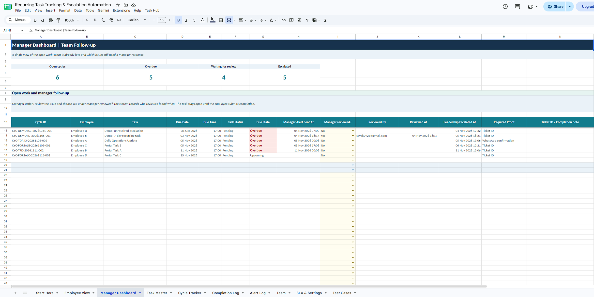
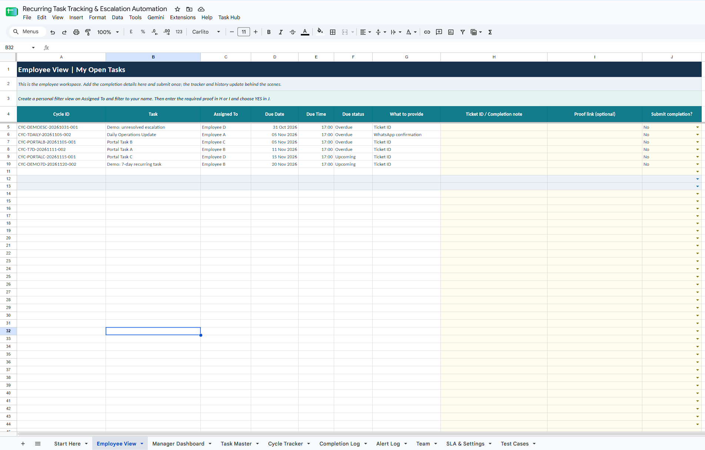
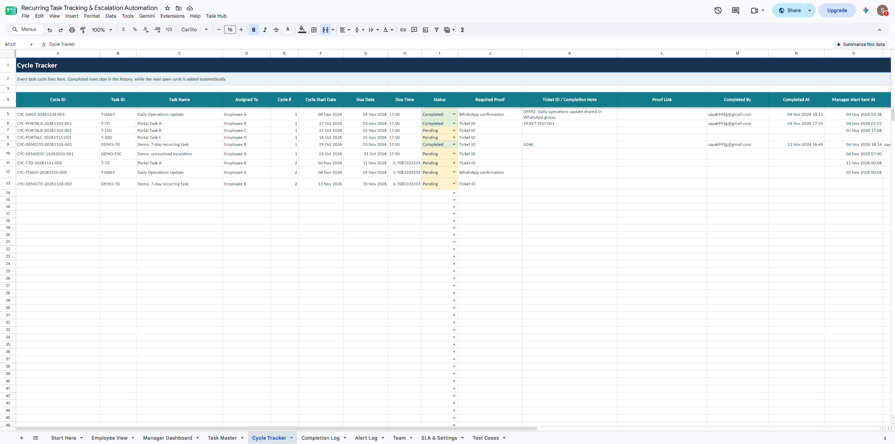
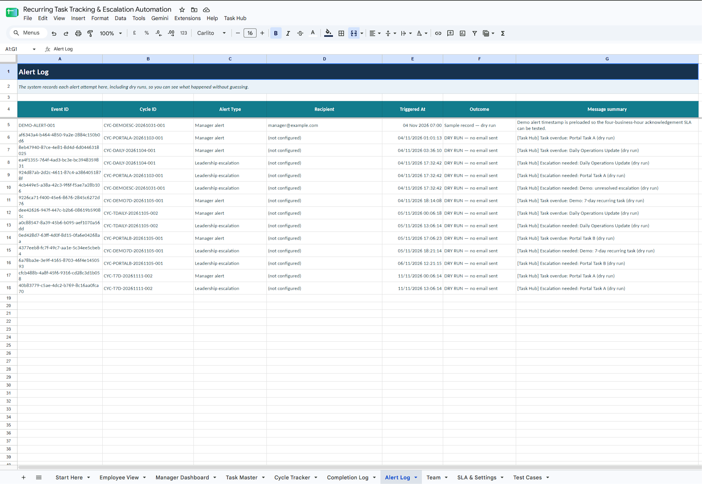
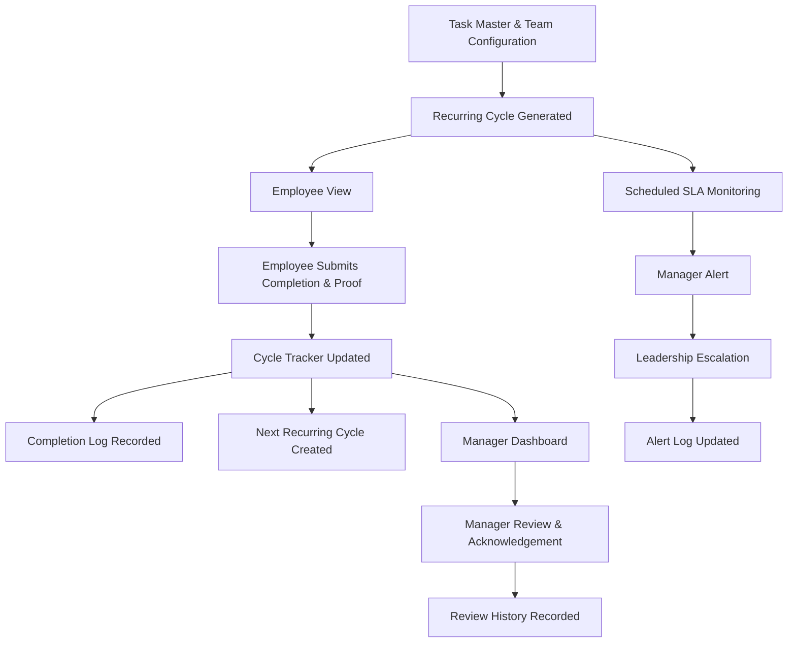

# Task Hub — Where Recurring Work Becomes Accountable

**A lightweight operations management system built with Google Sheets and Google Apps Script.**

Recurring work is easy to assign, but surprisingly difficult to track consistently. Tasks get missed, completion updates are scattered across different channels, and managers often have to chase people for evidence or status updates.

Task Hub addresses this gap by bringing recurring task management, employee completion updates, proof capture, manager review, and overdue-task escalation into one structured workspace.

The goal is simple: **make every task traceable, every completion accountable, and every overdue item visible.**

---

## Live Demo

**[Open the Task Hub Google Sheets Demo](https://docs.google.com/spreadsheets/d/1oRNAp8-d3uUxiuTOLgdPdFoQXn8DdSQuA-CtJD6u9s4/edit?usp=sharing)**

The live spreadsheet is shared with view-only access. It includes sample task cycles, employee views, completion records, manager acknowledgements, alert history, and test scenarios.

> The repository also contains a downloadable Excel workbook. The workbook is a static copy of the spreadsheet structure; the automated workflows run in Google Sheets through Apps Script.

---

## Interface Previews

The following images provide a visual overview of the system's main interfaces.

*Manager Dashboard — a central view of outstanding work and review activity.*

*Employee View — a single place to submit task completion updates and supporting information.*

*Cycle Tracker — the operational record for recurring task instances, due dates, completion status, and review history.*

*Audit Logs — historical completion records and notification or escalation events.*

*Note: These are illustrative interface previews. Refer to the live spreadsheet for the actual working implementation.*

---

## What It Does

Task Hub is designed around the complete lifecycle of a recurring task, from assignment to completion and follow-up.

### 1. Recurring task generation

Tasks can be configured with different recurrence frequencies:

- Daily
- Every 7 days
- Every 15 days
- Every 30 days

Once a task is completed, the system can automatically generate its next cycle, carrying forward the configured task information and calculating the next due date.

### 2. Centralised employee updates

Employees use a common Employee View to submit completion updates rather than editing multiple tracking sheets.

Depending on the task, the system captures:

- Completion confirmation
- Ticket ID or completion note
- Supporting evidence link
- Employee identity, where available
- Completion timestamp

For portal-related tasks, a Ticket ID is required before completion can be submitted.

For daily operational updates shared through WhatsApp, employees post the update in the designated group and then leave a confirmation in Task Hub. This is an acknowledgement-based workflow, not a direct WhatsApp integration.

### 3. Manager visibility and acknowledgement

The Manager Dashboard provides a consolidated view of pending work and items requiring review.

Managers can acknowledge completed work, with the reviewing account and timestamp recorded in the Cycle Tracker.

### 4. Automated alerts and escalation

A scheduled Apps Script routine checks task status against due dates and configured SLA thresholds.

The system maintains an alert history and supports escalation for unresolved work. Its demonstration configuration uses:

- **4 business hours** for manager review or acknowledgement.
- **24 calendar hours** for unresolved task escalation.

Dry Run Mode allows the notification logic to be demonstrated without sending actual emails.

### 5. Audit trail and duplicate prevention

Task Hub maintains separate operational and historical records:

- **Cycle Tracker:** Current and historical task-cycle status.
- **Completion Log:** A record of submitted completion updates.
- **Alert Log:** A record of manager notification and leadership escalation events.

The automation also uses duplicate checks and execution locking to help prevent repeated processing, duplicate completion records, and overlapping automation runs.

---

## How the Workflow Fits Together

---

## Workbook Structure

The spreadsheet is organised into nine functional areas.

| Sheet | Purpose |
|---|---|
| **Task Master** | Defines recurring tasks, owners, frequencies, and proof requirements. |
| **Team** | Stores employee and manager configuration. |
| **Cycle Tracker** | Maintains the operational record for each task cycle. |
| **Employee View** | Provides a central completion-update interface. |
| **Manager Dashboard** | Displays pending work and manager review activity. |
| **Completion Log** | Stores historical completion records. |
| **Alert Log** | Records notification and escalation events. |
| **SLA & Settings** | Controls timing thresholds and automation settings. |
| **Test Cases** | Documents demonstration scenarios and outcomes. |

---

## Technology Stack

- **Google Sheets:** Operational interface, configuration, tracking, and reporting.
- **Google Apps Script:** Automation and workflow logic, written in JavaScript.
- **Time-driven triggers:** Periodic checks for overdue tasks and SLA conditions.
- **Installable edit triggers:** Respond to changes and employee or manager actions within the spreadsheet.

The system uses Apps Script services such as `LockService` to reduce the risk of concurrent executions interfering with updates.

---

## Repository Contents

| File / Folder | Description |
|---|---|
| `Task_Hub_Automation.gs` | Google Apps Script source code. |
| `Task_Hub_Recurring_Task_Hub.xlsx` | Downloadable Excel version of the workbook. |
| `screenshots/` | Illustrative interface previews. |
| `README.md` | Project overview and documentation. |

---

## Demonstration & Testing

The prototype was exercised against practical scenarios covering recurring task creation, employee updates, manager acknowledgement, and SLA monitoring.

| Scenario | Outcome |
|---|---|
| Generate the next cycle for a completed 7-day recurring task. | Validated |
| Submit a portal task completion with a Ticket ID. | Validated |
| Record a daily operations update through employee confirmation. | Validated |
| Capture manager acknowledgement and review timestamp. | Validated |
| Generate manager alert events. | Demonstrated in Dry Run Mode |
| Generate leadership escalation events. | Demonstrated in Dry Run Mode |
| Run automation again without creating duplicate alert events. | Validated |
| Apply the configured 24-hour resolution threshold. | Configured; not independently verified through a separate 24-hour live wait |
| Prevent duplicate completion submissions. | Protection implemented in the script; deliberate duplicate submission was not separately tested |

**Notification testing note:** Dry Run Mode was used for the demonstration. Alert and escalation events were recorded in the workbook, but actual email delivery was not tested.

---

## Setup Guide

To run your own instance:

1. Download the Excel workbook or make a copy of the live Google Sheets demo.
2. Open the spreadsheet and navigate to **Extensions → Apps Script**.
3. Add the contents of `Task_Hub_Automation.gs` to the Apps Script project.
4. Review the Task Master, Team, and SLA & Settings sheets. Replace demonstration records and configure your own recipients.
5. Ensure the spreadsheet and Apps Script project use the same timezone.
6. Run the `setupAutomation()` function and authorise the requested permissions.
7. Verify that the time-driven and edit triggers have been installed.
8. Test the workflow with sample tasks while Dry Run Mode is enabled.
9. Enable actual email notifications only after checking the configured recipients and confirming that you are ready to send them.

---

## Current Scope & Limitations

Task Hub is a working prototype, not a fully integrated enterprise workflow platform. Some boundaries are intentional:

- WhatsApp updates are confirmed by employees in the spreadsheet. Messages are not automatically read or verified.
- Ticket IDs are required for applicable tasks, but the system does not independently validate them against an external portal.
- The Employee View is a shared spreadsheet interface, not a separate, access-isolated workspace for each employee.
- Daily recurrence skips weekends; a separate public-holiday calendar is not integrated.
- Email notifications were demonstrated using Dry Run Mode rather than live delivery.

These are potential areas for future development, including direct integrations, stronger role-based access controls, and more advanced reporting.

---

## Why This Project

Task Hub explores how familiar tools such as Google Sheets and Apps Script can be combined to solve a practical operations problem without introducing the overhead of a full-scale task management platform.

Beyond tracking whether a task is complete, the system is designed to preserve the context around it: who was responsible, when it was due, what evidence was submitted, who reviewed it, and whether an unresolved item required escalation.

**The underlying idea is that operational accountability should be built into the workflow, not left to follow-up reminders.**
